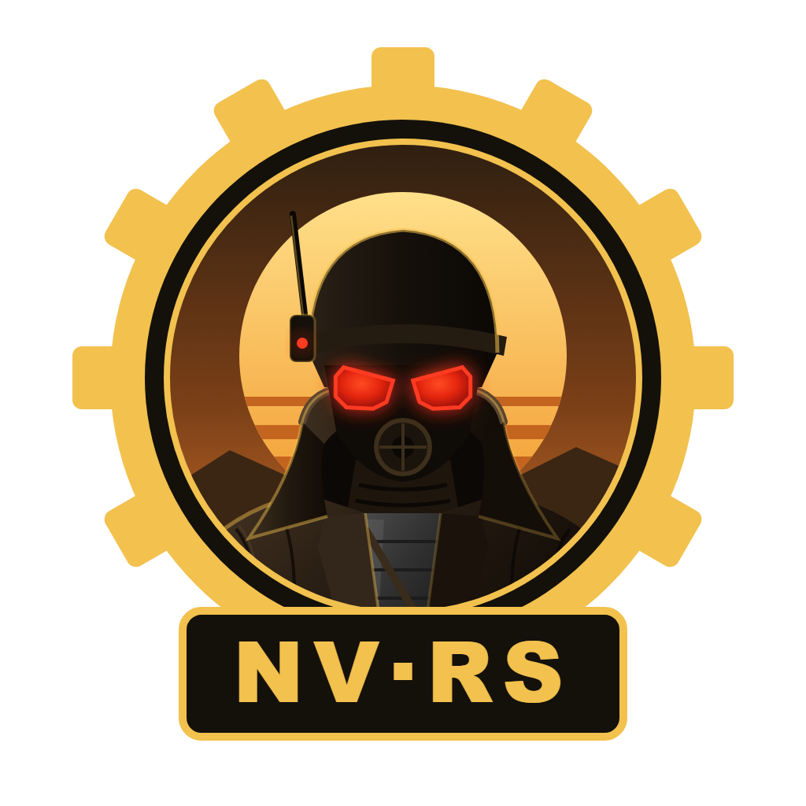
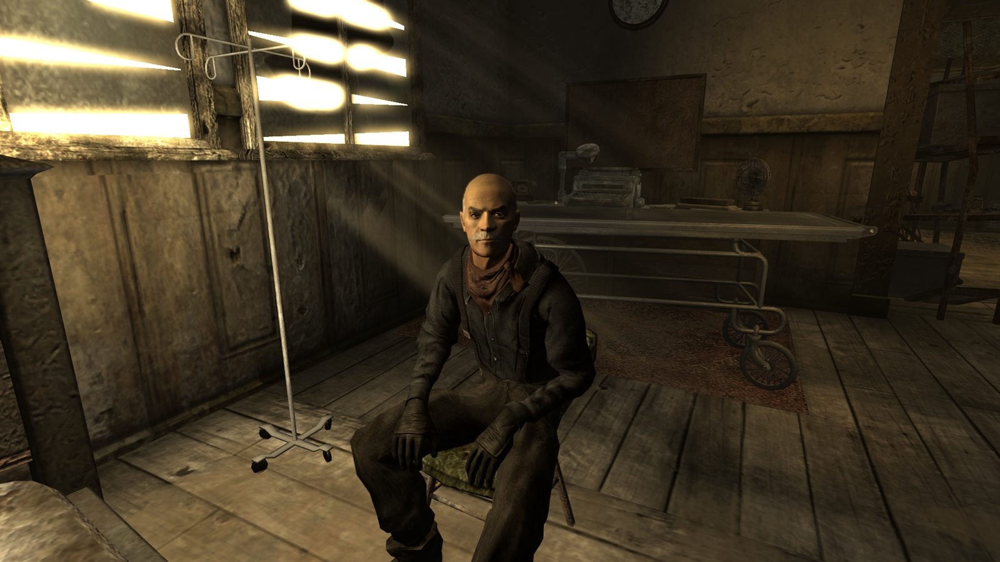
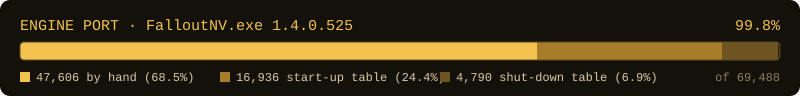

<p align="center">
  
</p>

<h1 align="center">nv-rs</h1>

[](https://www.rust-lang.org/)
[](https://bevyengine.org/)
[](LICENSE)
[](docs/PLAYTESTING.md)
[](docs/MILESTONES.md)

**Fallout: New Vegas, rebuilt in Rust, aiming to play exactly like the
original.**

nv-rs is a new engine for Fallout: New Vegas, written in Rust. It runs the
game from your own copy's files, and its goal is a faithful 1:1 match, down
to the original's quirks. Not a remake that feels close: the same game, on a
modern, open-source engine that can be fixed, ported and extended.

<p align="center">
  
  <br><sub><i>Goodsprings, rendered by nv-rs from the game's own files.</i></sub>
</p>

> [!IMPORTANT]
> nv-rs is an independent project, not affiliated with or endorsed by
> Bethesda Softworks, ZeniMax Media, Obsidian Entertainment or Microsoft. It
> contains no game files; you need your own legally obtained copy of the game.
> See [LEGAL.md](LEGAL.md).

---

## Why it's different

- **Translated from the original, not guessed.** The original game's program
  is translated into Rust piece by piece, and every piece is checked against
  the original. Nothing is tuned by eye.
- **Your game, your files.** nv-rs reads the game's own plugins, meshes,
  textures, sounds and menus from your installation and never changes them.
- **Built to last.** Open source and memory-safe, so fixes, new platforms and
  optional improvements are possible later.
- **Mods keep working.** Regular `.esp` and `.esm` mods load the way they do
  in the original.

## Where it stands

Experimental. Almost all of the original program is translated, and the game's
own code now runs: it starts a new game, plays the opening in Doc Mitchell's
house (Doc's speech, character creation, the Vit-o-Matic and his questions),
and lets you walk around, talk to Doc and use the Pip-Boy, with the original
graphics and sound.

<table>
  <tr>
    <td width="50%"></td>
    <td width="50%"></td>
  </tr>
  <tr>
    <td align="center"><sub><i>Waking up in Doc Mitchell's house.</i></sub></td>
    <td align="center"><sub><i>Ghost Town Gunfight: the Powder Gangers come to town.</i></sub></td>
  </tr>
</table>

Not yet: a full playthrough, the open world, script-extender (NVSE) plugins,
packaged Linux and macOS builds, and VR. Speed is the current focus: the goal
is to run faster than the original without changing how it plays.

## Progress

<p align="center">
  
</p>

Every function of the game's own code is translated. Not counted: 29 pieces of
Microsoft and Windows code that our own layer replaces, and a few fragments
that can never run. Some translated functions still have small marked gaps,
mostly error handling; the systems below are where the real work is now.

| | System | Status |
| :---: | --- | --- |
| ✅ | **Foundations:** the original program mapped, the engine running in play | Done |
| 🔨 | **Movement and physics** | Translated; running in the play build, being checked against the original |
| 🔨 | **Animation and faces** | Translated; running in the play build, being compared with the original |
| 🔨 | **Audio:** sounds, music and the radio | Translated; the game's own sound plays and matches the original |
| 🔨 | **Graphics:** lighting, weather and effects | Translated; the game's own renderer draws on Windows, other platforms later |
| 🔨 | **Gameplay:** combat, AI, quests, dialogue, menus, V.A.T.S., perks, crafting | Translated; the opening's dialogue, menus and Pip-Boy run, the rest is being switched on |
| ⬜ | **Saves and the open world** | Saves load in Doc's house; the open world comes later |

After that come optional bug fixes, script-extender compatibility and more
platforms. The details are in [docs/SYSTEMS.md](docs/SYSTEMS.md) and
[docs/MILESTONES.md](docs/MILESTONES.md).

---

## Try it

1. Download the latest Windows build from
   [Releases](https://github.com/slaterain/nv-rs/releases).
2. Extract it and run `Play.cmd`.
3. Point it at your own `Fallout New Vegas\Data` folder.

nv-rs needs Fallout: New Vegas version 1.4.0.525 installed. If anything behaves
differently from the original game, that's a bug worth reporting; tips are in
[docs/PLAYTESTING.md](docs/PLAYTESTING.md).

### Build from source

Install stable Rust, then:

```sh
cargo build --release && cargo test --workspace
cd viewer
cargo run --release -- "<path to Fallout New Vegas\Data>" GSDocMitchellHouse
```

The viewer also builds on macOS (Metal) and Linux (Vulkan, Wayland or X11);
see [docs/PLAYTESTING.md](docs/PLAYTESTING.md) for the packages each needs.

---

## How it's made

To be upfront: nv-rs is built almost entirely with AI coding agents (mainly
Claude, with some Codex). The maintainer directs the project: the plan, the
priorities, playtesting and what gets merged. The agents write nearly all of
the code.

What keeps it honest is the method. Agents don't get to invent behaviour:
every piece of logic is translated from the original game's program and
marked with where it came from, then checked by automated tests, automated
play-throughs and recordings of the original game. Anything that can't be
traced to the original doesn't go in. Everything is in the open, so judge it by
how it plays.

---

## Get involved

Contributions are welcome, from people and their AI agents alike:

1. Read [CONTRIBUTING.md](CONTRIBUTING.md) (and give [AGENTS.md](AGENTS.md)
   to your agent).
2. Open an issue saying what you'd like to work on, and wait for a
   go-ahead from the maintainer.
3. Open a small pull request against `main`.

The most useful help right now: testing builds and reporting differences from
the original, platform support and research into how the original behaves.

**Curious how it works?** Start with
[docs/ENGINE_PORT_PLAN.md](docs/ENGINE_PORT_PLAN.md) and
[docs/METHODOLOGY.md](docs/METHODOLOGY.md); every other document is linked
from [docs/](docs/).

Final decisions rest with the maintainer, **slaterain**
([docs/GOVERNANCE.md](docs/GOVERNANCE.md)).

## Legal and license

Original code is licensed under the [GNU GPL v3 or later](LICENSE). The
licence covers only original work. Fallout and Fallout: New Vegas are
trademarks of their respective owners. Read [LEGAL.md](LEGAL.md) for the full
notice.
