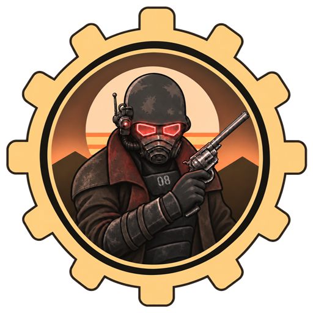
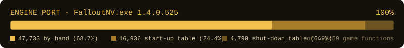

  

<h1 align="center">nv-rs</h1>

**Fallout: New Vegas, rebuilt in Rust, aiming to play exactly like the original.**

nv-rs is a new engine for Fallout: New Vegas, written in Rust. It runs the game from your own
copy's files. The goal: the game looks and plays exactly like the original, while everything
underneath becomes a modern 64-bit engine: no 4 GB memory limit, every CPU core in use, high frame
rates, fast loading, far fewer crashes, built-in modding and more platforms.

> [!IMPORTANT]
> nv-rs is an independent project, not affiliated with or endorsed by Bethesda Softworks, ZeniMax
> Media, Obsidian Entertainment or Microsoft. It contains no game files; you need your own legally
> obtained copy of the game. See [LEGAL.md](LEGAL.md).

---

## Play the preview

**[Download the Windows preview](https://github.com/slaterain/nv-rs/releases)**. You need
Fallout: New Vegas (version 1.4.0.525; only the Steam version has been tested so far) on a Windows PC.

Builds from source (not yet the preview) also recognize one GOG build: the en-US offline installer 1.4.0.525(a), build 55068 (see [GOG compatibility](docs/GOG_55068.md)).

1. Extract the ZIP to a folder of its own, for example `C:\Games\nv-rs`.
2. Double-click `Play.exe`. The launcher opens, in the look of the game's terminals; `> Play` finds
   your game and starts it.
3. `Import my saves.cmd` brings your saves over (in builds from source and the next preview, the
   launcher's `> Import saves` entry does it instead). The launcher's `> Settings` has the display options and the game fixes.

It never changes your game, your saves or your settings: everything it writes stays in its own
folder. Windows may warn because the program isn't signed. It has only been run on one PC so far:
please report how it runs on yours (press F12 in the game to make a report). Keyboard and mouse,
or an Xbox-style or PlayStation game pad on Windows; mods that need script-extender plugins don't
work yet. The download page lists the known issues.

## Where it stands

**Playable.** The whole game runs on its own translated code: the opening, the open world, quests,
dialogue, combat, V.A.T.S., the Pip-Boy, saves, mods and the DLCs, with the original graphics and
sound. Bugs remain, and it's slower than the original in busy places for now.

**Next:** moving the game's systems to native 64-bit Rust, which lifts the 4 GB memory limit and
brings the speed, and finishing the built-in mod tools. After that: more platforms, co-op and VR.

## Progress

  

The bar counts how much of the original game's code is translated. That part is done; the table
shows what's left. Each name links to the detail in [docs/STATUS.md](docs/STATUS.md).

| | System | What you get today |
| :---: | --- | --- |
| ✅ | [**The whole game**](docs/STATUS.md#the-whole-game) | Combat, AI, quests, dialogue, menus, saves, the open world and the DLCs, checked against the original and playable. |
| ✅ | [**Fixes**](docs/STATUS.md#fixes) | Bug fixes on by default, each with its own setting; the original's behaviour is one setting away. |
| ✅ | [**Windows preview**](docs/STATUS.md#windows-preview) | [Released](https://github.com/slaterain/nv-rs/releases); run on one PC so far. |
| 🔨 | [**Native 64-bit code**](docs/STATUS.md#native-64-bit-code) | Started: threads on their own cores, textures and sounds kept outside the 32-bit memory, and the first hot paths as native code (the script evaluator, the world draw's device calls, the actors' per-frame loops). |
| 🔨 | [**Built-in script extender: xNVSE**](docs/STATUS.md#xnvse-built-in) | All 654 of its script commands and both its script languages, with nothing to install. |
| 🔨 | [**Built-in script extender: JIP LN:**](docs/STATUS.md#jip-ln-built-in) | All its script commands (JIP LN: 1,116 and its two version commands) and all of its game patches that do something on this port (174 of 183; three more are folded into others, six do nothing here); on in the default fixes preset, off in vanilla (`bJIPInstalled=0` turns it off). |
| 🔨 | [**Mod Configuration Menu (MCM)**](docs/STATUS.md#mod-configuration-menu-mcm-built-in) | The commands MCM's menu needs; on in the default fixes preset (`bMCM=0` turns it off). |
| 🔨 | [**UI Organizer (UIO)**](docs/STATUS.md#ui-organizer-uio-built-in) | UI mods' HUD and menu additions; on in the default fixes preset (`bUIO=0` turns it off). |
| 🔨 | [**lStewieAl's Tweaks**](docs/STATUS.md#lstewieals-tweaks-built-in) | 225 of its changes, on by default: its 72 listed crash and leak fixes and 153 more fixes and tweaks; the remaining crash fixes and tweaks come next. |
| 🔨 | [**Mod installers (FOMOD)**](docs/STATUS.md#mod-installers-fomod) | Mods with an installer, from .zip or .7z, installed into nv-rs's own folder, never the game's. |
| 🔨 | [**One launcher**](docs/STATUS.md#the-launcher) | `Play.exe` opens a window like the game's terminals to play, install mods, import saves and change settings. |
| 🔨 | [**Modern graphics (wgpu)**](docs/STATUS.md#modern-graphics-wgpu) | The default renderer, on Vulkan; in the places compared, on one NVIDIA card, its pictures nearly match Direct3D 9's, and at 8x antialiasing it is about 8% slower. |
| 🔨 | [**Game pads**](docs/STATUS.md#game-pads) | Xbox-style pads on Windows as in the original; other pads, and Linux, not yet tried with a real pad. |
| ⬜ | [**More platforms, co-op, VR**](docs/STATUS.md#more-platforms-co-op-vr) | Planned; co-op has no design yet. |

✅ means working, not free of bugs. Each fix is described in [docs/FIXES.md](docs/FIXES.md); the
plan is in [docs/MILESTONES.md](docs/MILESTONES.md).

## Why it's different

- **Translated, not guessed.** The game's program is translated into Rust piece by piece, each
  piece checked against the original.
- **Your game, your files.** nv-rs reads the game's data from your installation and never changes it.
- **Modern underneath.** The internals become 64-bit Rust, whose memory and thread safety rule out
  whole classes of crashes.
- **Better where it doesn't change the game.** Fixes and upgrades are switchable; the original
  stays available.
- **Mods keep working.** Regular `.esp` and `.esm` mods load as they do in the original.

---

## How it's made

To be upfront: nv-rs is built almost entirely with AI coding agents (mainly Claude). The maintainer
directs the project: the plan, the priorities, playtesting and what gets merged.

What keeps it honest is the method: agents don't get to invent behaviour. Every piece of logic is
translated from the original game's program, marked with where it came from, and checked against
the original's own code and recordings of the original game. Judge it by how it plays.

## Get involved

- **Play and report:** try the preview and [open an issue](https://github.com/slaterain/nv-rs/issues)
  for anything that differs from the original.
- **Contribute:** read [CONTRIBUTING.md](CONTRIBUTING.md) (and give [AGENTS.md](AGENTS.md) to your
  agent), say in an issue what you'd like to work on, then open a small pull request.
- **Chat** on the project's [Discord](https://discord.gg/pn5kjZJJxx).
- **Support** the project on [Ko-fi](https://ko-fi.com/slater41n). It pays for the AI time the
  work runs on. It's a voluntary gift: it buys nothing and promises no release date.
- **Build from source:** see [docs/PLAYTESTING.md](docs/PLAYTESTING.md); every document is linked
  from [docs/README.md](docs/README.md).

Final decisions rest with the maintainer, **slaterain** ([docs/GOVERNANCE.md](docs/GOVERNANCE.md)).

## Legal and license

Original code is licensed under the [GNU GPL v3 or later](LICENSE). The licence covers only
original work. Fallout and Fallout: New Vegas are trademarks of their respective owners. Read
[LEGAL.md](LEGAL.md) for the full notice.
